# Desktop screens (planned)

PlantUML Salt cards for every screen and state of the Linux and Windows shell in
[ADR 0033](../decisions/0033-desktop-navigation-shell.md). Each card lists the control IDs the
implementation and its UI tests must use; IDs already in the current client keep their meaning.
The static prototype in `clients/desktop/prototype/` shows the same screens with the proposed
stylesheet; it is not shipped and has no logic. `make ui-prototype` saves every screen in English
and Russian at 440 and 1280 px to `build/ux-research/prototype/<screen>-<lang>-<width>.png`
([UI testing](../testing/ui-testing.md#desktop-prototype-screenshots)). The current one-page UI
stays until the redesign lands; [v0.0.1 client screens](v0.0.1-client-screens.md) holds the
behaviour contracts.

The prototype wording is a draft; the shipped strings stay in `clients/desktop/ui/i18n`.

## First run

`wizard-identity`: step 1 of 2. The system keyring is preselected when available; the file option
says the key is kept unencrypted. Nothing is created before **Create identity**.

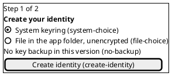

`wizard-network`: step 2 of 2, may be skipped. Same form and outcome as the Network screen.

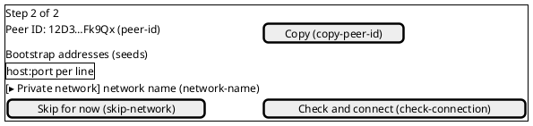

## Picker and recovery

`picker`: several identities and none active, or after a removal. `recovery`: the active identity
cannot be opened; the localized reason, then Details with the state code.

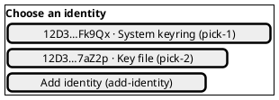

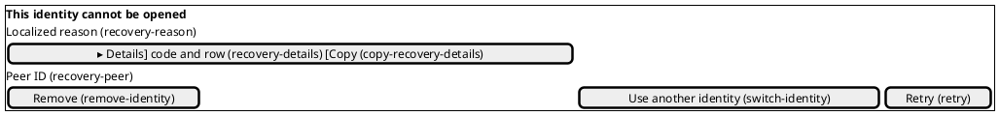

## Shell

Every later screen sits in the shell. `switcher` opens the identity menu; `menu` is the
off-canvas sidebar at 640 px and below, opened by `menu-open` in the top bar.

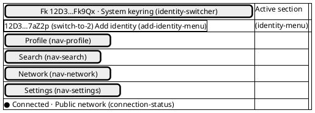

`connection-status` shows Connecting, Connected (one compatible node answered) or Offline and
opens Network.

## Profile

`profile`: the draft with **Hide from search**. `profile-hidden`: the switch is on, a tombstone is
published and a notice explains how to return. `profile-dark`: the same screen in the dark theme.

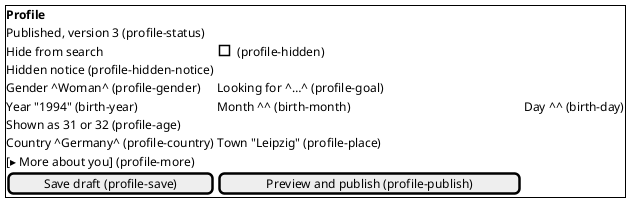

`publish-dialog` lists exactly the public fields and needs both boxes; `publish-progress` shows the
proof of work with elapsed time. Cancel is left and focused.

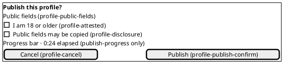

## Network

`network`, `network-checking` and `network-error`. One **Check and connect**; a failure or cancel
keeps the prior network. The error shows Details with the code and the row outcomes.

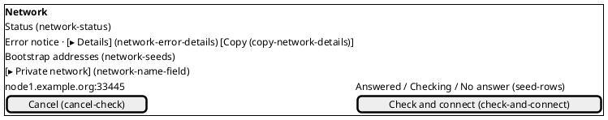

## Search

`search`, `search-loading`, `search-empty` and `search-error`.

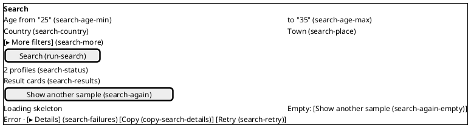

## Settings and removal

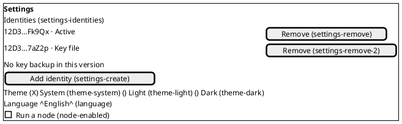

`remove-dialog` withdraws the profile with a tombstone, then deletes the key. `remove-offline`:
no node accepted the tombstone, so the dialog says the profile expires by itself within the
nodes' profile lifetime and offers Retry or Remove anyway.

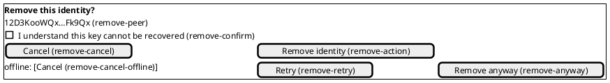
