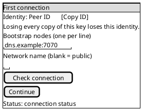
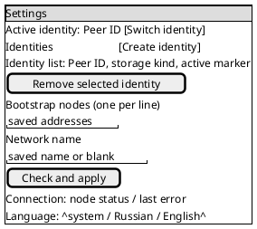
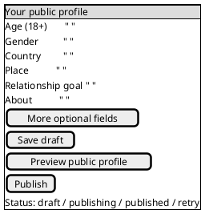
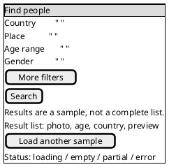

# v0.0.1 client screen draft

These PlantUML Salt cards are interaction sketches for Android and Linux first. They
describe controls and state, not pixels. The same IDs and actions apply to the later
iOS, macOS and Windows implementations; native layout and widgets may differ. The
current clients show only a stored identity and are not yet implementations of these
screens. The later cross-platform screen convention may refine this draft.

## Entry and network connection

On first launch, create or reopen exactly one identity before requesting network
details. Reopening a stored identity must never generate a replacement. The user
chooses file or available system storage on desktop; Android uses its platform store.
The identity-loss warning belongs next to creation. A network failure leaves the key
intact and returns to the connection form. An existing identity skips creation and
returns to its unfinished connection or profile step.

Accept DNS or IP addresses, bracket IPv6, and allow an optional peer-ID pin.
Reject malformed entries before dialing; show the offending row. Keep the saved
addresses and network name on retry. `continue-profile` is enabled only after a
successful check. Distinguish empty list, connecting, unreachable node, wrong
network or pin, and connected. Do not ask for account credentials or profile data
on this screen.

## Settings

This screen is per active identity except the identity list and app language.
The first release offers these controls; any control whose runtime is unfinished
must stay disabled with an explanation until it works. Network edits require an
explicit Apply action and a connection check; a failed check keeps the prior working
configuration. Each identity has its own bootstrap list and network name.

For `remove-identity`, show the exact Peer ID and whether its key is the last local
copy, require a second confirmation, and explain that deletion cannot be undone
without a backup. Do not delete a key while creating or switching identities. A
new identity starts a separate profile and conversations; there is no shared inbox.
Storage location is shown read-only for an existing key. Changing storage backend
requires an explicit migration flow and is outside this screen's first release.

The first-release settings inventory is: active identity selection, add/remove
identity, key storage location and backup instructions, bootstrap addresses,
network name, connection status/retry, app language, the optional mobile app lock,
and desktop window/tray behavior. Profile editing is reached from the profile
screen. Local preferences for view signals, presence audience, notifications,
screenshot protection and search filters are later work; they must not appear
as working toggles until their behavior exists. No hidden switch may silently
move a secret key to another backend.

### Mobile app lock

At first launch, offer **Skip**, **Set PIN** and **Use device biometrics** when
the device reports a usable biometric authenticator. The choice can be changed
or disabled in Settings. While locked, hide profile, messages and Peer ID even
if the device itself is unlocked; show only the unlock surface. Biometric
unavailability must explain why the option is disabled. The PIN recovery and
retry policy needs a separate security design before implementation; it must
not silently delete or regenerate an identity.

### Desktop window and tray

Remember the last usable normal window dimensions and maximized state. Restore
on-screen after a display change. Settings expose **Show icon in tray** and
**Close window to tray**; the latter is available only when a working tray
restore path exists. The tray/menu-bar icon offers at least **Open** and **Quit**.
Quit ends the process regardless of close-to-tray. Platform-specific behavior
for minimized state and menu-bar availability needs native validation; never
save a state that leaves the app invisible with no way to reopen it.

### Desktop storage and status

For each storage area with a quota, Settings shows its active directory and
used/total bytes, with a labelled usage bar when a total is known. A compact
status bar shows measured traffic and storage; it shows a user count only if a
defined source supplies one. Unknown values display “Unavailable” or are
omitted with an explanation, never a fabricated zero. The metric contract must
define scope, refresh interval and whether the source is local or a node before
implementation.

## Profile draft and publication

Show an 18+ gate before publication. Age and gender are the required self-declared
fields; all other fields are optional. A draft survives restart. Show the exact
public fields in preview and explain that published data can be copied by others
even after deletion. Publishing has pending, puzzle-work, retryable failure and
published states; cancellation preserves the draft.

Optional fields come from `proto/profile.proto`: income range, children and family
plans, education, orientation, role preference, career, employment, fitness,
interests, zodiac, financial philosophy and photos. Show only fields actually
supported by the profile schema and publication path. The proposed About field
still needs its schema/ADR work before its control can be enabled. Country and place
pickers must use known values, with a no-place choice. Preview and published
readback must agree after local signature verification.

## Search and results

Search returns a verified **sample**, not all matching profiles. Keep the query
locally so Back or retry does not lose it. Only offer filters supported by the
connected node and client-side predicate checks. Open a result to show the
verified public profile; never mark self-declared claims as verified facts.

Loading blocks duplicate requests, not navigation. Empty results say that a sample
contained no verified matches, not that none exist. Partial results keep visible
matches and explain the limitation. No nodes, proof-of-work rejection, rate limit,
timeout and invalid responses have distinct messages and a retry action. The
client verifies signatures and every predicate before displaying a result; a bad
result is dropped and never shown as a person.

## Layout and review rules

At phone width each card is one scrollable column with persistent primary action;
at desktop width the form and context/status may sit side by side, but controls,
order of decisions and IDs stay the same. Every input needs a visible label,
keyboard focus, error announcement and translated EN/RU copy. Destructive actions
must be accessible without relying on color. These cards omit exact spacing and
visual styling. Stable control IDs for implementation are the kebab-case names
of the controls in the paragraphs (for example `bootstrap-addresses`,
`apply-network`, `profile-age`, `run-search`); preserve them across platforms.
Salt makes the fields and sequence diffable; prose above carries
validation and state transitions, which Salt alone does not express.

## App icon direction

Use one simple mark across platforms: two light circular nodes connected by a
short coral bridge, centered on a dark plum rounded square. It represents two
people finding a private connection without text, a lock, or a promise of verified
identity. Keep the silhouette legible at 24 px and in a monochrome mask. The
existing 32 px solid-color desktop icon is a placeholder. Ship a vector master,
required platform sizes and a light/dark contrast check before v0.0.1; exact
paths and exports belong to the icon implementation task.
