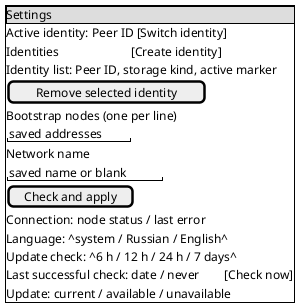
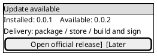
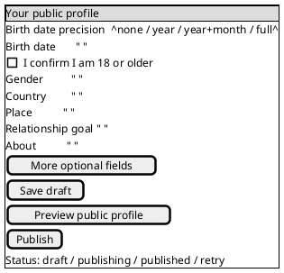
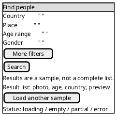

# v0.0.1 client screen draft

These PlantUML Salt cards are interaction sketches for Android and Linux first. They
describe controls and state, not pixels. The same IDs and actions apply to the later
iOS, macOS and Windows implementations; native layout and widgets may differ. The
current clients implement parts of this draft; publication and search screens remain
planned. The later cross-platform screen convention may refine this draft.

## Entry and network connection

On first launch, create or reopen exactly one identity before requesting network
details. Reopening a stored identity must never generate a replacement. The user
chooses file or available system storage on desktop; Android uses its platform store.
Desktop and Android can already keep several identities in independent slots.
Android opens the per-identity editable network draft on launch when no active connection exists;
a configured identity reaches it from the ready screen. Its per-slot connection checker is
available to the client. Android now displays ordered row outcomes and a connection summary;
cancel/retry controls and activation UI remain planned.
Apple clients now resolve legacy and UUID identities without automatic creation; first use
requires an explicit Create action. Their network draft bridge addresses the selected
identity folder. On creation or reopening, they read that identity's active network off the UI
thread: no active network opens the draft form automatically, while a configured identity reaches
the Ready screen. An unreadable active file shows a retryable error without creating another key.
The shared iOS/macOS form now loads ordered bootstrap rows and an optional
network name from the selected identity's draft or active settings. Save draft persists edits
for that identity without activating them. An unreadable file
displays an error without replacing the key. The picker and
add/switch controls remain planned in
[Apple identity storage](../development/apple-identity-storage.md).
The Apple form now runs the per-identity bounded Check action and shows ordered, localized row
outcomes plus a connected or failed summary. Check saves the draft but leaves active settings
untouched. Cancel stops a running check and Retry checks the same edited draft. Continue is
enabled only after a compatible result for the unchanged draft, activates that checked draft
off the UI thread, then opens the profile editor.
Before exposing Cancel, the Apple form saves the current draft off the UI thread. Even a Cancel
pressed before the Rust checker starts therefore keeps the edited rows across a restart.
Native Apple tests cover invalid address, invalid peer ID, duplicate and unreachable outcomes
in order, with no active configuration written by those checks.
They also cover a reached node with the wrong pin or network name; neither enables Continue.
The identity-loss warning belongs next to creation. A network failure leaves the key
intact and returns to the connection form. An existing identity skips creation and
returns to its unfinished connection or profile step.

Accept DNS or IP addresses, bracket IPv6, and allow an optional peer-ID pin.
Reject malformed entries before dialing; show the offending row. Keep the saved
addresses and network name on retry. `continue-profile` is enabled only after a
successful check. Distinguish empty list, connecting, unreachable node, wrong
network or pin, and connected. Do not ask for account credentials or profile data
on this screen.

### Connection contract (planned)

`NetworkDraft` belongs to one identity and contains an ordered list of seed
addresses plus `networkName`. A seed is `host:port` or `host:port/<peer ID>`;
DNS and IPv4 hosts are bare, IPv6 hosts have brackets, and port is required.
The example port is 33445, not an implicit fallback for an address without a
port. Reject multiaddrs and duplicate rows. A peer-ID suffix pins the node's
transport key. `networkName` follows [ADR 0017](../decisions/0017-network-names.md):
printable ASCII, at most 64 bytes, no surrounding spaces, empty for public.
Neither the network name nor the seed list is an account credential.

Save draft edits per identity before dialing so a crash or restart does not
discard what the user entered. The active configuration changes only after
`check-connection` reaches a compatible node and the user continues or applies
it in Settings. A failed edit leaves the prior active connection configuration
intact. The app stores both the draft and active configuration locally with the
selected identity; switching identities never copies them. Key creation/opening
is a separate operation and never runs in a connection retry.

`dyapp_identity::network` stores them as `network-draft` and `network` in the
identity's slot folder (the root for the legacy slot), each replaced atomically.
Rows are kept verbatim, so a saved explicit port such as 7070 is never rewritten.
A missing file means nothing was saved: an empty draft and no active
configuration. A damaged file is an error, never silently reset. Removing the
identity deletes both with its folder.

| Action code | Effect |
|---|---|
| `save-draft` | Persist edits for the active identity without connecting. |
| `check-connection` | Validate the draft and start a bounded attempt against its seeds. |
| `cancel-check` | Stop the attempt and keep the draft and prior active configuration. |
| `activate-connection` | Commit the successfully checked draft for this identity. |
| `retry-connection` | Repeat the check on the same draft without touching the identity key. |

| State code | UI meaning and available action |
|---|---|
| `empty` | No seed; ask for at least one address. |
| `invalid-address` / `invalid-network` | Show the exact field or row; keep edits and allow correction. |
| `checking` | Disable duplicate checks; allow Cancel. |
| `connected` | At least one pinned or unpinned node answered on the selected network; show its node ID and allow Continue/Apply. |
| `unreachable` | All attempted nodes timed out or refused connection; show per-row cause and Retry. |
| `wrong-peer` / `wrong-network` | A reached node failed its pin or network check; show the affected row and Retry after correction. |
| `cancelled` | Keep draft, restore the prior active configuration and allow Check. |

Validate every row before a check, then attempt all configured seeds with a
bounded timeout. Preserve per-row results when some nodes fail; one compatible
node is enough to continue, but a mismatched pinned node must never count as a
success. UI strings come from stable state codes and arguments, not raw Rust
errors. `dyapp_client::seeds` checks the rows and the Android FFI exports it as
`ConnectionCheck` ([FFI design](../architecture/ffi-design.md)). The Linux and Windows apps
mirror it as the Tauri commands `load_network`, `save_network_draft`, `check_connection`,
`cancel_connection_check` and `activate_connection` in `clients/desktop/network.rs`; rows
come back as `{status}` maps and errors as the codes `empty`, `cancelled`, `notChecked` or
`invalidNetwork: <reason>`. Their page shows the form under the open identity's Peer ID, filled
from the draft or else the active settings; edits are saved on change, any edit disables Continue
until the next successful check, and Continue calls `activate_connection`.

## Settings

This screen is per active identity except the identity list and app language.
The Linux Settings screen now exposes Create and Switch through the existing storage-choice and
identity-picker flows. Choosing Create still requires an explicit key backend and shows the file
backup warning; opening the picker alone does not change the active identity. Remove opens the
existing Peer ID, storage-mode and backup-warning screen with a second checkbox confirmation;
Cancel returns to Settings with the identity intact.
The desktop Settings screen reuses the active identity's network editor DOM node; Back returns it
to the first-entry Ready view with unsaved rows and check status intact.
The shared Apple Settings screen lists local legacy and UUID identities,
showing each available Peer ID or recovery state, device Keychain plus local key file and the
active marker.
It opens the selected identity's network editor. Create adds a UUID slot only after an explicit
tap; Switch validates the existing key before changing the active pointer. Failed actions show
an error and keep the current identity. Remove is available only for the selected UUID slot. It
shows the exact Peer ID and a last-local-copy warning when appropriate, requires a destructive
confirmation, and then resolves the remaining identities without silently selecting another.
Legacy and damaged slots have no Remove control. The picker lists reopened Peer IDs, allows an
explicit selection or creation, and keeps damaged/deleting entries visible but unavailable.
The first release offers these controls; any control whose runtime is unfinished
must stay disabled with an explanation until it works. Network edits require an
explicit Apply action and a connection check; a failed check keeps the prior working
configuration. Each identity has its own bootstrap list and network name.

For `remove-identity`, show the exact Peer ID and whether its key is the last local
copy, require a second confirmation, and explain that deletion cannot be undone
without a backup. Do not delete a key while creating or switching identities. A
new identity starts a separate profile and conversations; there is no shared inbox.
Storage location is shown read-only for an existing key. Changing storage backend
requires an explicit migration flow and is outside this screen's first release.

The first-release settings inventory is: active identity selection, add/remove
identity, key storage location and backup instructions, bootstrap addresses,
network name, connection status/retry, app language, the optional mobile app lock,
desktop window/tray behavior, and the app-wide update-check interval and status.
Profile editing is reached from the profile screen. Local preferences for view
signals, presence audience, message notifications, screenshot protection and
search filters are later work; they must not appear
as working toggles until their behavior exists. No hidden switch may silently
move a secret key to another backend.

### Update notice

The update interval and last successful check are app-wide, not per identity.
The **Check now** action and notice states follow the
[client update design](client-updates.md). Show a compact, dismissible notice for
one newer version at a time, with installed and available versions and a
platform-specific manual action. Keep an update badge in Settings until that
version is installed. A source-build target says explicitly that the user must
build/sign it; an unsigned Apple artifact is never labelled ready to install.

### Mobile app lock

The app lock is mobile-only, and no later desktop release is planned to add it. Linux, macOS and
Windows rely on the OS screen lock. The lock is a UI gate only; it never protects stored keys.

**Android implements first-launch Skip/Set PIN, PIN unlock and an app-lock settings screen that
sets, changes or turns off the PIN, OS-credential unlock and reset of a forgotten PIN, and device
biometrics in place of the PIN. iOS implements first-launch Skip/Set PIN, PIN unlock on every
fresh start, the covered app-switcher snapshot, the background and idle relock, and a settings
screen from the start screen that sets a PIN, or changes or turns it off behind the current PIN;
a PIN needs a device passcode, whose check on the unlock screen unlocks the app and replaces or
turns off a forgotten PIN. Device biometrics replace the PIN at first launch or in the settings;
under them the OS check is the only unlock, and the settings open only after a fresh one.**
The Android settings screen opens from the main screen and asks for the current PIN before
changing or turning off an existing one; five wrong entries there show only the
device-credential notice. While a PIN is set, Android keeps the app out of the app-switcher
snapshot; before API 33 this also blocks screenshots. Android starts with a locked
lifecycle state, then reads its saved PIN choice and checks timing before it constructs private UI.
Without a device screen lock, its setup screen explains
in place why Set PIN is unavailable and keeps Skip. Its unlock screen always offers **Use device
screen lock**, the only way on after five wrong PINs; success unlocks and opens settings, where a
new PIN or Turn off needs no current PIN. Without a device screen lock that button is disabled
and the screen explains how to restore it. The lock is
app-wide, so switching identities cannot bypass it. At first launch, offer **Skip**, **Set PIN**
and **Use device biometrics** when the device reports a usable biometric authenticator. PIN and
biometrics require an enabled device screen credential, which is the recovery method. Explain
an unavailable option in place. Settings can change or disable the choice only after the current unlock method or
a fresh device-credential check. A failed or unavailable biometric check falls back to the OS
device credential. Android uses `BIOMETRIC_STRONG | DEVICE_CREDENTIAL`; iOS uses
`deviceOwnerAuthentication` ([Android](https://developer.android.com/reference/android/hardware/biometrics/BiometricPrompt.Builder),
[Apple](https://developer.apple.com/documentation/LocalAuthentication/LAPolicy/deviceOwnerAuthentication)).

An app PIN is a separate secret of six to 64 ASCII decimal digits. Store a random 128-bit salt and
an Argon2id verifier (64 MiB, three passes, four lanes, 32-byte tag) in device-only protected
storage; never store, log or back up the PIN. These are the memory-constrained parameters from
[RFC 9106](https://www.rfc-editor.org/rfc/rfc9106.html#section-4). Android protects that record
with an Android Keystore key in `noBackupFilesDir`; iOS keeps it in a `ThisDeviceOnly` Keychain
item. Validate unlock latency on supported devices before enabling PIN mode. Five wrong PINs
require OS device-credential authentication before another PIN attempt. A successful device-
credential check can reset a forgotten PIN without deleting an identity. If the device credential
is removed or unavailable, keep the app locked and explain that it must be restored; never clear
app data or silently generate a replacement identity.

Obscure the app immediately on backgrounding, including its app-switcher snapshot. Require unlock
after 60 seconds in the background, after five minutes without foreground interaction, and on
every fresh process start. Returning before the background grace period can restore the existing
unlocked session. While locked, show only the unlock surface: hide profiles, messages and Peer IDs,
and do not show content in notifications. The lock does not encrypt the local SQLite database or
replace the platform key backend ([storage decision](../decisions/0025-client-local-sqlite-storage.md)).
A compromised OS can bypass an app UI lock ([threat model](../security/threat-model.md#client-side-exposure)).

| Choice | Pros | Cons | Decision |
| --- | --- | --- | --- |
| Separate app PIN with OS-credential recovery | Protects against casual access to an unlocked app; forgetting the PIN does not destroy identities. | Needs a protected verifier, retry state and platform UI. | Use for first mobile release. |
| OS credential only | Uses system retry limits and needs no app PIN verifier. | Offers no separate app PIN despite the first-launch choice. | Keep as recovery and biometric fallback. |
| App PIN without recovery | Keeps device credential separate from app access. | A forgotten PIN can strand the user while identity backup is unavailable. | Reject. |

### Desktop window and tray

Remember the last usable normal window dimensions and maximized state. Restore
on-screen after a display change. Settings expose **Show icon in tray** and
**Close window to tray**; the latter is available only when a working tray
restore path exists. The tray/menu-bar icon offers at least **Open** and **Quit**.
Quit ends the process regardless of close-to-tray. Platform-specific behavior
for minimized state and menu-bar availability needs native validation; never
save a state that leaves the app invisible with no way to reopen it.

The window state lives in a small file in the app config directory, beside the
identity files, written when the window closes or the app quits. A missing or
unreadable file means the default: 1024×720 logical pixels, centred, not
maximized. The minimum window is 480×560, so every screen stays usable.

| Behaviour | Linux | macOS | Windows |
|---|---|---|---|
| Saved | normal size, position, maximized | same | same |
| Not saved | minimized, fullscreen | minimized, fullscreen | minimized |
| Restore off-screen | if less than 1/4 of the window or none of its title bar is on a current display, centre it on the primary display at the saved size, shrunk to fit | same | same |
| Tray available | a StatusNotifierItem host is on the session D-Bus (`org.kde.StatusNotifierWatcher`); GNOME without an extension has none | menu-bar extra, always | notification area, always |
| Show icon in tray | default on when available; disabled with a reason otherwise | default on | default on |
| Close window to tray | default off; enabled only while the tray icon is shown | default off; off means closing keeps the app in the Dock, as macOS apps do | default off |
| Close with close-to-tray off | quits | hides the window; Dock click or the menu-bar Open reopens it | quits |
| Tray menu | Open, Quit | Open, Quit | Open, Quit |
| Quit (ends the process) | tray Quit or Ctrl+Q | Cmd+Q, app menu or menu-bar Quit | tray Quit or Ctrl+Q |

If the tray host disappears while the window is hidden, the app shows the
window again. Turning off **Show icon in tray** also turns off **Close window to
tray**. A second launch of the app shows and focuses the running window.

### Desktop storage and status

For each storage area with a quota, Settings shows its active directory and
used/total bytes, with a labelled usage bar when a total is known. A compact
status bar shows measured traffic and storage; it shows a user count only if a
defined source supplies one. Unknown values display “Unavailable” or are
omitted with an explanation, never a fabricated zero.

All sources are local to the device; no number comes from a node. Bytes use
binary units (KiB, MiB, GiB) with one decimal.

| Label | Source | Unit | Refresh | Unavailable when |
|---|---|---|---|---|
| Identity directory | The app config directory that holds `identity-storage` and, in file mode, `identity.key` | path | on Settings open | path cannot be resolved: “Unavailable” |
| Message store | The client store database file and its `-wal`/`-shm` siblings | path, bytes used | on Settings open, then every 10 s while open | file missing or unreadable: “Unavailable” |
| Free on disk | Filesystem free space for the volume of the message store | bytes | with Message store | the OS call fails: omitted |
| Traffic in / out | Sum of all `WireBytes` slots of the client swarm, in and out, since app start | bytes | every 2 s | no network started yet: “Unavailable” |
| Storage (status bar) | Message store bytes used | bytes | every 10 s | as Message store |

No store has a quota in v0.0.1, so no usage bar is drawn; a bar appears only for
a store with a configured limit. Traffic counts payload bytes of dyapp protocols
only, not transport, encryption or gossip control overhead; the tooltip says so.
It resets on app start and is labelled “since start”, so nothing is summed
twice across restarts. The user count is omitted: no source supplies one.

## Profile draft and publication

Show an 18+ self-attestation before publication. Every profile field, including
gender and the planned partial birth date, is optional, including no date at all
([ADR 0029](../decisions/0029-partial-public-birth-date.md)). A draft survives
restart. Show the exact
public fields in preview and explain that published data can be copied by others
even after deletion. Publishing has pending, puzzle-work, retryable failure and
published states; cancellation preserves the draft.

Optional fields come from `proto/profile.proto`: income range, children and family
plans, education level, orientation, role preference, career ambition, profession,
company, industry, career stage, work-life balance, employment, fitness,
interests, zodiac, financial philosophy and photos. Show only fields actually
supported by the profile schema and publication path. The proposed About field
still needs its schema/ADR work before its control can be enabled. Country and place
pickers must use known values, with a no-place choice. Preview and published
readback must agree after local signature verification.

**Birth-date integration contract.** The editor has three separate optional
numeric controls: year, month and day. Start each absent, store absence as `None`,
and permit month/day without a year. Validate the combined parts with the profile
core; never infer an omitted part. Preview the exact parts that will be public,
and warn that a full date discloses more than a partial one. Show "age unknown"
without a year. With a year, call `Profile::possible_age_range(today)` using the
current UTC civil date and display its inclusive youngest–oldest range (or the
single age when equal); if it returns `None`, show unknown age. Do not display a
self-declared integer age: Profile tag 3 is reserved.

Every publish requires a fresh explicit 18+ self-attestation. If a year is
supplied, block publishing when `possible_age_range(today)` is absent or its
youngest age is below 18; without a year, rely on the attestation. Revalidate
when publishing, not only when editing the draft. The client core stores one
draft per identity (`Store::save_profile_draft`, `Store::profile_draft`) and
applies this gate in `publish::check`, which also rejects birth parts that form
no date. Every categorical field, including gender, may remain unpublished as zero.
`publish::work` advances the profile proof of work in short steps and keeps the
next nonce in the draft, so a cancelled publish
resumes there; the solved proof is reused by later versions. `publish::publish`
sends the next version, and on `STALE` (a lost reply, or a newer version from
another device) reads the held record and publishes above it. It succeeds only
when the signed readback equals the published profile, then saves that as the
draft and holds it for search; any failure leaves the draft unchanged for a
retry.

The Apple UniFFI `profile_publish_block` exposes the shared eligibility check for the saved
identity draft at the current UTC day, without creating a database on read. `ProfileSolve`
advances the 11-bit proof in short saved steps and responds to cancellation; a new handle resumes
from the stored nonce. `ProfilePublisher.publish` now uses the active network and returns the
shared core's verified signed readback, preserving the draft on failure.
The shared Apple editor now shows separate 18+ and public-data confirmations and checks the saved
draft through `profile_publish_block` off the UI thread. Edits and saves clear both confirmations;
unsaved edits disable confirmation until saved. Save and preview never require confirmations. The
editor now runs the 11-bit proof in short background steps, shows persisted progress, and allows
cancellation. A retry creates a new handle and resumes the stored nonce; each attempt clears the
confirmations. Once solved, the editor publishes through the active network and displays the
returned signed readback version and exact public fields. A localized failure keeps the draft and
offers retry after both confirmations are repeated.

The Linux and Windows app keeps the draft in `client.db` of the identity folder.
Its page shows localized pickers for all nine closed scales plus the three birth parts,
backed by `load_profile`, `save_profile` and `profile_scales`; saving retains the unpublished
fields and proof-of-work progress. Preview lists the selected public fields, exact date
parts and possible age range, with disclosure warnings. Publishing requires a fresh 18+
confirmation and a separate acknowledgement that public data may remain available after
deletion. An edit or publish attempt clears both confirmations. The page shows puzzle and
readback progress and allows puzzle cancellation or a retry after failure. The
`solve_profile`, `cancel_profile_solve` and `publish_profile` commands
back that flow. The puzzle needs 11 bits, the default search-node minimum; taking the
size from node hints is planned.

Android, iOS and macOS show localized pickers for the same Rust-defined scales through
`profile_scales` in UniFFI. They save a local draft under the active identity in app storage.
Android also saves independently optional birth year, month and day; it rejects impossible
combinations before replacing the local draft. These drafts are not yet wired to the profile
publishing runtime. iOS/macOS now save the same independently optional birth parts in each
identity's local draft and use UniFFI `assess_birth_parts` for validation before replacing the
saved draft. Missing parts remain absent. Android preview and publish, and Apple preview and
publish, remain planned. `ProfileService` is still a placeholder.
The Apple editor and preview now read the identity-bound Rust `client.db` draft; an older local
JSON draft is imported once when the Rust draft is absent and retained as a recovery copy. The
preview reads saved values, maps only nonzero scale codes through the shared
profile vocabulary, shows the exact optional birth parts and inclusive age bounds from the shared
core, and warns about copying and full-date disclosure. Unsaved edits never appear in preview.
The 18+ attestation and separate public-data acknowledgement belong to the planned publish flow;
neither gates saving or previewing.

## Search and results

Search returns a verified **sample**, not all matching profiles. Keep the query
locally so Back or retry does not lose it. Only offer filters supported by the
connected node and client-side predicate checks. Open a result to show the
verified public profile; never mark self-declared claims as verified facts.

Loading blocks duplicate requests, not navigation. Empty results say that a sample
contained no verified matches, not that none exist. Partial results keep visible
matches and explain the limitation; the Rust search result marks partial when a
node skips the age condition, fails or leaves a reply incomplete. No nodes,
proof-of-work rejection, rate limit,
timeout and invalid responses have distinct messages and a retry action. The
client verifies signatures and every predicate before displaying a result; a bad
result is dropped and never shown as a person.

### Local compatibility evidence

After verification, the client can compare its own signed profile with each verified
result locally. The pure `rust/client::compatibility::compare` helper returns
`matches` and `compared` counts for six optional dimensions: profession, company,
industry, career stage, work-life balance and income. For each of the five
text fields, count one comparison only when both profiles publish a nonempty value;
an exact NFC string match adds one match.
Free-text aliases and different spelling do not match. For income, count one comparison
only when both profiles publish complete ranges and the same nonempty country; inclusive
range overlap adds one match. A different or missing country never compares income.

Missing values neither match nor count as a comparison. A result with zero comparisons
has no compatibility evidence, not a zero-percent compatibility judgment. The client
may show the counts and order only its verified result sample by `matches`, preserving
sample order on ties. It must not call the count a probability, use it as a hard filter,
or send the comparison or private preferences to a search node. The helper is
implemented; the UI is planned. Exact text matches are deliberately conservative; a later
controlled vocabulary or private preferences would need a separate design.

## Layout and review rules

At phone width each card is one scrollable column with persistent primary action;
at desktop width the form and context/status may sit side by side, but controls,
order of decisions and IDs stay the same. Every input needs a visible label,
keyboard focus, error announcement and translated EN/RU copy. Destructive actions
must be accessible without relying on color. These cards omit exact spacing and
visual styling. Stable control IDs for implementation are the kebab-case names
of the controls in the paragraphs (for example `bootstrap-addresses`,
`apply-network`, `profile-age`, `run-search`); preserve them across platforms.
Salt makes the fields and sequence diffable; prose above carries
validation and state transitions, which Salt alone does not express.

## App icon direction

Use one simple mark across platforms: two light circular nodes connected by a
short coral bridge, centered on a dark plum rounded square. It represents two
people finding a private connection without text, a lock, or a promise of verified
identity. Keep the silhouette legible at 24 px and in a monochrome mask. The
existing 32 px solid-color desktop icon is a placeholder. The vector master is
`../../assets/icon.svg`. Run `python3 tools/scripts/generate-app-icon.py` to
produce the Linux 32 px PNG and the Windows PNG/ICO from it. Android uses an
adaptive vector foreground and monochrome layer within the launcher safe zone.
iOS uses the same mark on an opaque 1024 px asset; macOS has a multiscale
asset catalog.
Inspect the icon at 24/32 px and on light/dark
backgrounds before v0.0.1.
