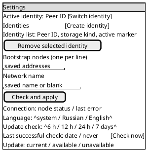
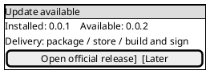
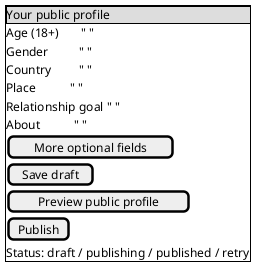
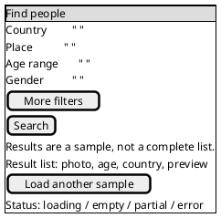

# v0.0.1 client screen draft

These PlantUML Salt cards are interaction sketches for Android and Linux first. They
describe controls and state, not pixels. The same IDs and actions apply to the later
iOS, macOS and Windows implementations; native layout and widgets may differ. The
current clients show only a stored identity and are not yet implementations of these
screens. The later cross-platform screen convention may refine this draft.

## Entry and network connection

On first launch, create or reopen exactly one identity before requesting network
details. Reopening a stored identity must never generate a replacement. The user
chooses file or available system storage on desktop; Android uses its platform store.
The identity-loss warning belongs next to creation. A network failure leaves the key
intact and returns to the connection form. An existing identity skips creation and
returns to its unfinished connection or profile step.

Accept DNS or IP addresses, bracket IPv6, and allow an optional peer-ID pin.
Reject malformed entries before dialing; show the offending row. Keep the saved
addresses and network name on retry. `continue-profile` is enabled only after a
successful check. Distinguish empty list, connecting, unreachable node, wrong
network or pin, and connected. Do not ask for account credentials or profile data
on this screen.

### Connection contract (planned)

`NetworkDraft` belongs to one identity and contains an ordered list of seed
addresses plus `networkName`. A seed is `host:port` or `host:port/<peer ID>`;
DNS and IPv4 hosts are bare, IPv6 hosts have brackets, and port is required.
The example port is 33445, not an implicit fallback for an address without a
port. Reject multiaddrs and duplicate rows. A peer-ID suffix pins the node's
transport key. `networkName` follows [ADR 0017](../decisions/0017-network-names.md):
printable ASCII, at most 64 bytes, no surrounding spaces, empty for public.
Neither the network name nor the seed list is an account credential.

Save draft edits per identity before dialing so a crash or restart does not
discard what the user entered. The active configuration changes only after
`check-connection` reaches a compatible node and the user continues or applies
it in Settings. A failed edit leaves the prior active connection configuration
intact. The app stores both the draft and active configuration locally with the
selected identity; switching identities never copies them. Key creation/opening
is a separate operation and never runs in a connection retry.

| Action code | Effect |
|---|---|
| `save-draft` | Persist edits for the active identity without connecting. |
| `check-connection` | Validate the draft and start a bounded attempt against its seeds. |
| `cancel-check` | Stop the attempt and keep the draft and prior active configuration. |
| `activate-connection` | Commit the successfully checked draft for this identity. |
| `retry-connection` | Repeat the check on the same draft without touching the identity key. |

| State code | UI meaning and available action |
|---|---|
| `empty` | No seed; ask for at least one address. |
| `invalid-address` / `invalid-network` | Show the exact field or row; keep edits and allow correction. |
| `checking` | Disable duplicate checks; allow Cancel. |
| `connected` | At least one pinned or unpinned node answered on the selected network; show its node ID and allow Continue/Apply. |
| `unreachable` | All attempted nodes timed out or refused connection; show per-row cause and Retry. |
| `wrong-peer` / `wrong-network` | A reached node failed its pin or network check; show the affected row and Retry after correction. |
| `cancelled` | Keep draft, restore the prior active configuration and allow Check. |

Validate every row before a check, then attempt all configured seeds with a
bounded timeout. Preserve per-row results when some nodes fail; one compatible
node is enough to continue, but a mismatched pinned node must never count as a
success. UI strings come from stable state codes and arguments, not raw Rust
errors. The client runtime and FFI surface for this contract do not exist yet.

## Settings

This screen is per active identity except the identity list and app language.
The first release offers these controls; any control whose runtime is unfinished
must stay disabled with an explanation until it works. Network edits require an
explicit Apply action and a connection check; a failed check keeps the prior working
configuration. Each identity has its own bootstrap list and network name.

For `remove-identity`, show the exact Peer ID and whether its key is the last local
copy, require a second confirmation, and explain that deletion cannot be undone
without a backup. Do not delete a key while creating or switching identities. A
new identity starts a separate profile and conversations; there is no shared inbox.
Storage location is shown read-only for an existing key. Changing storage backend
requires an explicit migration flow and is outside this screen's first release.

The first-release settings inventory is: active identity selection, add/remove
identity, key storage location and backup instructions, bootstrap addresses,
network name, connection status/retry, app language, the optional mobile app lock,
desktop window/tray behavior, and the app-wide update-check interval and status.
Profile editing is reached from the profile screen. Local preferences for view
signals, presence audience, message notifications, screenshot protection and
search filters are later work; they must not appear
as working toggles until their behavior exists. No hidden switch may silently
move a secret key to another backend.

### Update notice

The update interval and last successful check are app-wide, not per identity.
The **Check now** action and notice states follow the
[client update design](client-updates.md). Show a compact, dismissible notice for
one newer version at a time, with installed and available versions and a
platform-specific manual action. Keep an update badge in Settings until that
version is installed. A source-build target says explicitly that the user must
build/sign it; an unsigned Apple artifact is never labelled ready to install.

### Mobile app lock

At first launch, offer **Skip**, **Set PIN** and **Use device biometrics** when
the device reports a usable biometric authenticator. The choice can be changed
or disabled in Settings. While locked, hide profile, messages and Peer ID even
if the device itself is unlocked; show only the unlock surface. Biometric
unavailability must explain why the option is disabled. The PIN recovery and
retry policy needs a separate security design before implementation; it must
not silently delete or regenerate an identity.

### Desktop window and tray

Remember the last usable normal window dimensions and maximized state. Restore
on-screen after a display change. Settings expose **Show icon in tray** and
**Close window to tray**; the latter is available only when a working tray
restore path exists. The tray/menu-bar icon offers at least **Open** and **Quit**.
Quit ends the process regardless of close-to-tray. Platform-specific behavior
for minimized state and menu-bar availability needs native validation; never
save a state that leaves the app invisible with no way to reopen it.

The window state lives in a small file in the app config directory, beside the
identity files, written when the window closes or the app quits. A missing or
unreadable file means the default: 1024×720 logical pixels, centred, not
maximized. The minimum window is 480×560, so every screen stays usable.

| Behaviour | Linux | macOS | Windows |
|---|---|---|---|
| Saved | normal size, position, maximized | same | same |
| Not saved | minimized, fullscreen | minimized, fullscreen | minimized |
| Restore off-screen | if less than 1/4 of the window or none of its title bar is on a current display, centre it on the primary display at the saved size, shrunk to fit | same | same |
| Tray available | a StatusNotifierItem host is on the session D-Bus (`org.kde.StatusNotifierWatcher`); GNOME without an extension has none | menu-bar extra, always | notification area, always |
| Show icon in tray | default on when available; disabled with a reason otherwise | default on | default on |
| Close window to tray | default off; enabled only while the tray icon is shown | default off; off means closing keeps the app in the Dock, as macOS apps do | default off |
| Close with close-to-tray off | quits | hides the window; Dock click or the menu-bar Open reopens it | quits |
| Tray menu | Open, Quit | Open, Quit | Open, Quit |
| Quit (ends the process) | tray Quit or Ctrl+Q | Cmd+Q, app menu or menu-bar Quit | tray Quit or Ctrl+Q |

If the tray host disappears while the window is hidden, the app shows the
window again. Turning off **Show icon in tray** also turns off **Close window to
tray**. A second launch of the app shows and focuses the running window.

### Desktop storage and status

For each storage area with a quota, Settings shows its active directory and
used/total bytes, with a labelled usage bar when a total is known. A compact
status bar shows measured traffic and storage; it shows a user count only if a
defined source supplies one. Unknown values display “Unavailable” or are
omitted with an explanation, never a fabricated zero.

All sources are local to the device; no number comes from a node. Bytes use
binary units (KiB, MiB, GiB) with one decimal.

| Label | Source | Unit | Refresh | Unavailable when |
|---|---|---|---|---|
| Identity directory | The app config directory that holds `identity-storage` and, in file mode, `identity.key` | path | on Settings open | path cannot be resolved: “Unavailable” |
| Message store | The client store database file and its `-wal`/`-shm` siblings | path, bytes used | on Settings open, then every 10 s while open | file missing or unreadable: “Unavailable” |
| Free on disk | Filesystem free space for the volume of the message store | bytes | with Message store | the OS call fails: omitted |
| Traffic in / out | Sum of all `WireBytes` slots of the client swarm, in and out, since app start | bytes | every 2 s | no network started yet: “Unavailable” |
| Storage (status bar) | Message store bytes used | bytes | every 10 s | as Message store |

No store has a quota in v0.0.1, so no usage bar is drawn; a bar appears only for
a store with a configured limit. Traffic counts payload bytes of dyapp protocols
only, not transport, encryption or gossip control overhead; the tooltip says so.
It resets on app start and is labelled “since start”, so nothing is summed
twice across restarts. The user count is omitted: no source supplies one.

## Profile draft and publication

Show an 18+ gate before publication. Age and gender are the required self-declared
fields; all other fields are optional. A draft survives restart. Show the exact
public fields in preview and explain that published data can be copied by others
even after deletion. Publishing has pending, puzzle-work, retryable failure and
published states; cancellation preserves the draft.

Optional fields come from `proto/profile.proto`: income range, children and family
plans, education level, orientation, role preference, career, employment, fitness,
interests, zodiac, financial philosophy and photos. Show only fields actually
supported by the profile schema and publication path. The proposed About field
still needs its schema/ADR work before its control can be enabled. Country and place
pickers must use known values, with a no-place choice. Preview and published
readback must agree after local signature verification.

## Search and results

Search returns a verified **sample**, not all matching profiles. Keep the query
locally so Back or retry does not lose it. Only offer filters supported by the
connected node and client-side predicate checks. Open a result to show the
verified public profile; never mark self-declared claims as verified facts.

Loading blocks duplicate requests, not navigation. Empty results say that a sample
contained no verified matches, not that none exist. Partial results keep visible
matches and explain the limitation. No nodes, proof-of-work rejection, rate limit,
timeout and invalid responses have distinct messages and a retry action. The
client verifies signatures and every predicate before displaying a result; a bad
result is dropped and never shown as a person.

## Layout and review rules

At phone width each card is one scrollable column with persistent primary action;
at desktop width the form and context/status may sit side by side, but controls,
order of decisions and IDs stay the same. Every input needs a visible label,
keyboard focus, error announcement and translated EN/RU copy. Destructive actions
must be accessible without relying on color. These cards omit exact spacing and
visual styling. Stable control IDs for implementation are the kebab-case names
of the controls in the paragraphs (for example `bootstrap-addresses`,
`apply-network`, `profile-age`, `run-search`); preserve them across platforms.
Salt makes the fields and sequence diffable; prose above carries
validation and state transitions, which Salt alone does not express.

## App icon direction

Use one simple mark across platforms: two light circular nodes connected by a
short coral bridge, centered on a dark plum rounded square. It represents two
people finding a private connection without text, a lock, or a promise of verified
identity. Keep the silhouette legible at 24 px and in a monochrome mask. The
existing 32 px solid-color desktop icon is a placeholder. The vector master is
`../../assets/icon.svg`. Run `python3 tools/scripts/generate-app-icon.py` to
produce the Linux 32 px PNG and the Windows PNG/ICO from it. Android uses an
adaptive vector foreground and monochrome layer within the launcher safe zone.
iOS uses the same mark on an opaque 1024 px asset; macOS has a multiscale
asset catalog.
Inspect the icon at 24/32 px and on light/dark
backgrounds before v0.0.1.
